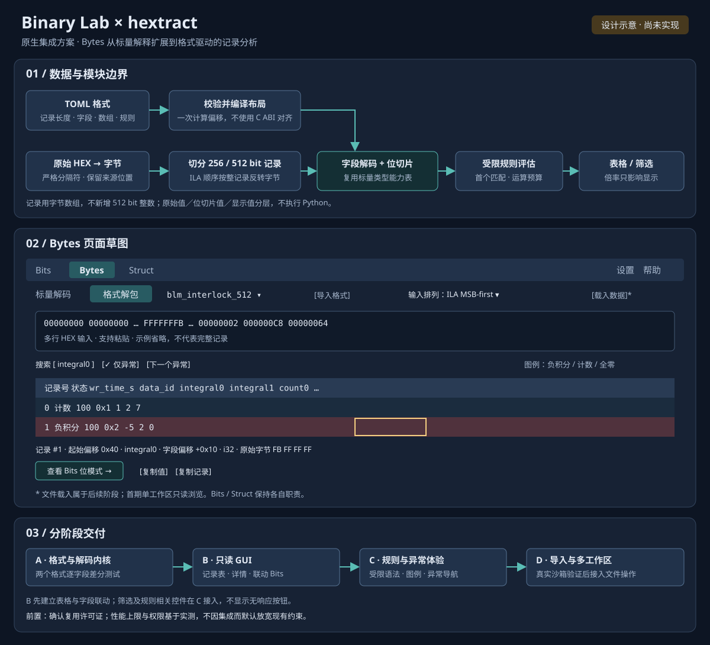

# Bytes / Struct 工作台执行文档

> 状态：设计与执行基线
>
> 范围：在现有 Binary Lab 工作台中实现 `bytes` 与 `struct` 两个交互页面。
>
> 本文基于当前 SVG 页面草图和现有代码边界编写。**2026-11-06 更新**：第 4 节的
> 标量与记录两种模式已随 v0.3b 实现（位编辑仍属 Phase 2，未做），第 13 节的
> Hextract Phase A–D 主体已落地；两节均按实际交付改写，未实现的部分显式标注
> “暂缓”。Struct 页（第 5 节）仍是设计稿。

## 1. 目标与非目标

### 1.1 目标

1. 将当前 bytes / struct 占位页替换为可交互的原生 GDI 页面。
2. 复用现有 `evalBytes()` 和 `evalStruct()` 的解析、解码、布局计算结果。
3. 保持查询层纯内存、无文件副作用；交互修改只作用于工作台当前会话。
4. 让用户能明确区分：
   - 输入文本；
   - 当前有效结果；
   - 当前选区或成员；
   - 修改尚未应用的草稿；
   - 布局定义与结构体实例值。
5. 为每个页面建立可重复的逻辑测试、GUI 驱动测试和截图验收标准。

### 1.2 非目标

首期不实现以下内容：

- 文件打开、保存、拖拽导入和导出文件；
- 网络访问、外部进程调用和宿主文件系统写入；
- bytes 页面中的插入、删除、批量重排；
- 修改 struct 布局规则本身；
- C 位域、指针、`long`、`size_t` 等当前解析器明确拒绝的 ABI 构造；
- 一次性展开数千个数组元素；
- 将 CRC / checksum 伪装成已经存在的能力。

CRC、校验和与奇偶校验可以作为 bytes 页的后续阶段，但当前仓库只有 bits 页的 parity UI，尚没有独立的 CRC 计算内核。

## 2. 当前代码基线

### 2.1 工作台外壳

- 页面模式定义在 [`editor.h:46-70`](file:///D:/dev/github/winshun-dev/ra9fael.binarylab/editor.h#L46-L70)，已有 `Bits`、`Bytes`、`Struct`、`Settings`、`Help` 五个模式。
- GUI 状态位于 [`editor.h:92-171`](file:///D:/dev/github/winshun-dev/ra9fael.binarylab/editor.h#L92-L171)。当前已有 `endian`、`pack`，但没有 bytes 字节数组、选区、struct 实例字节或成员编辑草稿。
- 当前非 bits 页面共用固定高度，布局逻辑见 [`editor.h:697-716`](file:///D:/dev/github/winshun-dev/ra9fael.binarylab/editor.h#L697-L716)。
- 当前 bytes / struct 内容仍是占位文本，见 [`editor.h:1651-1662`](file:///D:/dev/github/winshun-dev/ra9fael.binarylab/editor.h#L1651-L1662)。
- 当前非 bits 页状态栏只显示端序或 pack，并在第二行显示“功能将在 v0.3b/v0.3c 提供”，见 [`editor.h:1691-1747`](file:///D:/dev/github/winshun-dev/ra9fael.binarylab/editor.h#L1691-L1747)。
- 鼠标事件目前只处理 tab、bits 芯片、位格和设置页，见 [`editor.h:1877-1982`](file:///D:/dev/github/winshun-dev/ra9fael.binarylab/editor.h#L1877-L1982)。bytes / struct 需要增加独立的命中区域和事件分支。

### 2.2 bytes 逻辑层

现有模型位于 [`logic.h:1757-1779`](file:///D:/dev/github/winshun-dev/ra9fael.binarylab/logic.h#L1757-L1779)：

- `ByteWord`：offset、typeName、primary、detail、bitsHex、chain、width、isFloat；
- `BytesEval`：format、typeName、normalized、dump、preview、detail、chain、data、words、trailing。

`evalBytes()` 位于 [`logic.h:1880-1953`](file:///D:/dev/github/winshun-dev/ra9fael.binarylab/logic.h#L1880-L1953)，当前已支持：

- `hex`、`bin`、`oct`；
- `u8/i8/u16/i16/u32/i32/u64/i64/f32/f64` 及端序后缀；
- 默认端序；
- 最多 16 KiB 输入、4096 字节解码；
- 完整 normalized 字节流、hexdump、word 解码、尾部不完整字节报告。

结果生成见 [`logic.h:2001-2043`](file:///D:/dev/github/winshun-dev/ra9fael.binarylab/logic.h#L2001-L2043)：预览最多展示 `kMaxWordRows` 个 word，复制明细最多展开 64 个 word，但完整 normalized 与 hexdump 保留。

### 2.3 struct 逻辑层

现有模型位于 [`logic.h:2047-2084`](file:///D:/dev/github/winshun-dev/ra9fael.binarylab/logic.h#L2047-L2084)：

- `MemberRow`：name、typeName、kind、offset、size、align；
- `Layout`：name、definition、text、memberTable、assertions、byteMap、chain、isUnion、pack、size、align、members。

布局计算见 [`logic.h:2118-2189`](file:///D:/dev/github/winshun-dev/ra9fael.binarylab/logic.h#L2118-L2189)，当前已处理：

- 自然对齐与 `pack=1/2/4/8/16`；
- struct / union；
- padding / tail padding；
- 数组、嵌套结构、具名类型；
- 最大 256 个成员、4096 字节布局、4096 个数组元素等限制。

文本结果、成员表、static_assert 和 byte map 生成见 [`logic.h:2198-2266`](file:///D:/dev/github/winshun-dev/ra9fael.binarylab/logic.h#L2198-L2266)。

### 2.4 宿主设置与入口

- `defaultEndian` 和 `defaultPack` 在 [`main.cpp:20-48`](file:///D:/dev/github/winshun-dev/ra9fael.binarylab/main.cpp#L20-L48) 读取。
- 查询层通过 [`main.cpp:505-509`](file:///D:/dev/github/winshun-dev/ra9fael.binarylab/main.cpp#L505-L509) 调用 `evalBytes()` / `evalStruct()`。
- 打开工作台目前始终创建 Bits 模式，入口见 [`main.cpp:536-570`](file:///D:/dev/github/winshun-dev/ra9fael.binarylab/main.cpp#L536-L570)。bytes / struct 页需要先决定是从对应查询结果的 action 打开，还是从 bits 工作台切换后读取当前查询结果。
- `plugin.json` 已有 `defaultEndian`、`defaultPack` 设置，见 [`plugin.json:31-44`](file:///D:/dev/github/winshun-dev/ra9fael.binarylab/plugin.json#L31-L44)。

## 3. 总体交互原则

### 3.1 结果与草稿分离

所有页面都维护两份状态：

- `committed`：最近一次成功解析和应用的结果；
- `draft`：用户正在编辑但尚未成功应用的输入。

解析失败时：

- 不清空 committed 结果；
- 输入框保留 draft；
- 状态栏显示稳定的错误码和 token；
- 修改型控件暂时禁用，避免用户误把旧结果当成新输入；
- 成功后一次性替换 committed，并清除错误状态。

### 3.2 只在用户动作时写入剪贴板

查询和实时解析不碰剪贴板。以下行为才允许复制：

- 点击复制按钮；
- 对选中的字节 / 成员执行复制动作；
- 使用页面规定的快捷键。

### 3.3 端序只影响多字节解释

端序改变 `u16/u32/u64/i16/i32/i64/f32/f64` 的解码方式，不改变底层字节数组的顺序。

单字节类型始终使用固定顺序；HEX/BIN/OCT 格式切换只改变输入展示方式，不重新排列字节。

### 3.4 选区必须始终可见

状态栏和右侧详情必须同时显示：

- 起始 offset；
- 结束 offset；
- 字节数量；
- 当前解释类型；
- 是否包含尾部不完整 word。

## 4. Bytes 页面执行方案（已实现，2026-11-06）

本节描述**已随 v0.3b 交付**的形态。与最初设计稿的差异用“与原案不同”标出。

### 4.1 页面分区

#### 表达式框（规范输入，与原案一致）

页面切换到 Bytes 后共用工作台唯一的单行表达式框，内容是完整 bytes 查询的参数
部分，例如 `hex u16le 34 12 78 56` 或 `fmt blm_rawdata_256 lsb <hex...>`。
bits / bytes 两个模式各自保留一份表达式文本（`bitsExpr` / `bytesExpr`），切换
页签时保存与恢复，恢复后立即重新求值。不引入第二个输入框，历史记录全页共用。

#### 标量模式（`hex|bin|oct [TYPE] DATA...`）

内容区是三段网格，每行 16 字节：

- 行首 offset（永远可见）；
- 中间十六进制字节；
- 右侧 ASCII（可打印字符显示，否则显示 `.`，选区同步高亮）。

顶部工具条（与原案不同：不用下拉，全部是按钮，与 bits 页同一套视觉）：

1. 位宽 8 / 16 / 32 / 64 与符号 u / i——重写表达式里的类型词；
2. LE / BE——重写 `le` / `be` 端序后缀；
3. 「→ 位运算」——把当前字的原始位交给 bits 页。

当前字的读出是三个 chip（与原案不同：没有 OCT chip，也没有 8 位编辑格）：
HEX / DEC|FLOAT（浮点类型显示 FLOAT，含 IEEE-754 说明）/ BIN，点击即复制。

选中状态：

- 单击：选中一个字节；
- 鼠标拖动：形成连续选区（`selAnchor` / `selActive`）；
- 方向键：移动活动字节，网格自动滚动跟随；
- 滚轮：上下翻行；Shift+滚轮：横向翻列（本模式无横向列，预留接口）；
- Ctrl+C：复制整个选区的连续 hex。

视觉规则与原案一致：活动字节强边框、选区浅色填充、ASCII 同步高亮、offset
永远可见、超出可视区滚动而非撑高窗口。

#### 记录模式（`fmt <name> [lsb|msb] <hex...>`）

原案没有这一形态；随 hextract 集成（第 13 节）加入：

- 顶行是格式下拉按钮 + 当前格式的备注 / 错误；下拉列出内置与 `formatDir`
  目录的全部格式，坏文件保留一条红色错误条目；
- 下方是记录表格：每条记录一行、每个字段一列（数组字段按元素展开，如
  `integral0..integral5`，最多 512 列，`firstCol` 起横向滚动）；命中规则的行
  按规则的 `bg` / `fg` 着色，规则求值错误以红字标在该行；
- 点击单元格选中记录 / 字段，chip 显示该字段的十进制 / 十六进制值（应用
  `radix` / `scale` 后的显示值）；
- LSB / MSB 按钮重写表达式里的字节序词（缺失时插入）；
- 滚轮翻记录，Shift+滚轮横向翻列；
- 「→ 位运算」在此模式把选中字段的原始位交给 bits 页。

#### 底部状态区

两行状态栏（与原案不同：不预留 CRC 区，校验内核完成前不出现）：

- 行 1：上下文说明（格式名 + 记录数 / 类型 + 字节数 / 错误）、选区范围、
  最近一次操作反馈（复制成功等，2000 ms 消退）；
- 行 2：操作提示（拖选、滚轮、Ctrl+C、Esc）。

### 4.2 Bytes 状态模型

未引入独立的结构体，按现有 GUI 线程风格平铺在 `EditorState`（与原案不同的
命名）：`bitsExpr` / `bytesExpr` / `editOwner`（表达式文本的归属）、
`scalarHas` / `recordsHas` 与 `bytesEval` / `recordsEval`（committed 结果，
失败时保留上一次有效值）、`selAnchor` / `selActive` / `byteDrag` / `scrollRow`
（标量选区）、`selRecord` / `selField` / `firstCol`（记录选区）、
`recFmt` / `colChars`（当前格式与列宽缓存）。原案的五条不变量全部成立：
`begin <= active <= end`；offset 不越界；committed 为空不画选区与数值；
重解析后活动字节钳制到范围内；类型 / 端序切换不改变 `data` 字节顺序。

### 4.3 Bytes 解析流程（已实现，只读）

- `EN_CHANGE` → `evaluateBytes()`：`fmt` 前缀走 `evalRecords()`，否则
  `evalBytes(text, endian)`；
- 成功：替换 committed，重算列宽与布局（`computeBytesLayout()`），输出
  `layout:` 行供驱动脚本解析；失败：保留 committed，状态行 2 显示完整错误；
  空表达式：回到空白状态；
- 类型 / 端序改变：不改字节数组，重写表达式词后重新求值（与原案的“重新解析”
  策略一致）；
- **位编辑暂缓**：原案 Phase 2（活动字节 8 位编辑格、click toggle、drag
  paint）未实现。修改字节请走「→ 位运算」到 bits 页，或等后续切片；
- 复制动作：chip 点击复制当前字、Ctrl+C 复制选区 hex（原案的四项复制里
  “完整 normalized 流”由查询结果的 `copyPrimary` 承担）。

### 4.4 验收（已通过）

见 TESTPLAN.md L11：驱动脚本第 8 节覆盖标量打开、单击 / 拖选、chip 复制、
端序重写、→ 位运算、记录模式全流程与三张截图，`ALL CHECKS PASSED`；
逻辑测试 378/378（L10 覆盖格式模型与 TOML 加载）。

## 5. Struct 页面执行方案

### 5.1 页面分区

#### 定义编辑区

顶部保留当前表达式框，但改为多行编辑控件。内容是 struct 查询的定义部分，例如：

```text
struct Frame {
    u8 sof;
    u32 seq;
    u16 len;
    u8 data[2];
};
```

旁边提供：

- pack：natural / 1 / 2 / 4 / 8 / 16；
- 实例端序：LE / BE；
- 重新计算按钮；
- dirty 状态。

多行定义不采用“每次按键都重算”的策略。推荐行为：

- 普通输入只更新 draft；
- Ctrl+Enter 重新计算；
- 点击“重新计算”重新计算；
- 切换页面时，如果有未提交 draft，提示用户继续编辑或恢复 committed。

#### 布局摘要

显示：

- 类型名；
- `sizeof`；
- `alignof`；
- pack；
- padding 总量；
- union / struct 标识；
- 解析成功或错误状态。

padding 总量由 `MemberRow.kind == "padding"` 或 `"tail"` 的 size 累加得到，不新增第二套布局算法。

#### 布局图与成员表

布局图按 byte offset 绘制，最多直接展示 256 个字节；超过部分显示聚合提示。已有 `Layout.byteMap` 的文本结果只作为复制和调试依据，GUI 应根据 `members` 重新绘制可点击块。

成员表列：

- member；
- type；
- offset；
- size；
- align；
- kind。

规则：

- 普通 member 可选中；
- padding / tail padding 可查看但不可编辑；
- union 成员 offset 都为 0，视觉上允许重叠，不能按普通 struct 顺序绘制；
- 数组显示为一个折叠节点，只有用户展开时才生成元素行；
- 嵌套结构显示为可展开节点，默认只显示聚合成员摘要。

#### 成员编辑区

选中普通标量 member 后显示：

- 成员名、类型、offset、size；
- 当前实例值；
- 数值输入框；
- 原始字节；
- HEX / BIN / OCT / DEC 或 FLOAT；
- 位格；
- 应用按钮；
- 复制该成员值和字节按钮。

修改成员值只更新实例字节，不改变 `Layout`：

- `sizeof` 不变；
- `alignof` 不变；
- 所有 offset 不变；
- padding 内容保持不变，除非明确设计为允许编辑。

### 5.2 Struct 状态模型

建议分为布局状态和实例状态：

```cpp
struct StructInstance {
    std::vector<std::uint8_t> bytes;
    std::string endian = "le";
    std::size_t selectedMember = 0;
    bool hasSelection = false;
};

struct StructViewState {
    std::string definitionDraft;
    std::string definitionCommitted;
    binlab::Layout layout;
    StructInstance instance;
    int expandedDepth = 0;
    bool dirty = false;
    bool inputError = false;
};
```

必须禁止把实例值直接塞回 `Layout.members`：布局数据和实例数据是两个不同层次。

### 5.3 Struct 实例字节的生成规则

当前 `evalStruct()` 已生成布局，但没有实例值。因此需要新增一个纯逻辑层函数，例如：

```cpp
Outcome<std::vector<std::uint8_t>> makeStructInstance(
    const Layout& layout,
    const std::map<std::string, Value>& values,
    const std::string& endian);
```

首期只支持标量成员和一层数组元素值；未赋值成员使用零值，但 UI 必须显示“默认 0”或“未设置”，不能让用户误以为来自输入。

该函数负责：

1. 分配 `layout.size` 大小的零初始化缓冲区；
2. 按 `MemberRow.offset` 写入成员；
3. 按成员类型和实例端序编码；
4. 检查值范围；
5. 不写入 padding，除非后续明确制定 padding 初始化策略。

浮点成员按 IEEE-754 编码，复用现有浮点解析和格式化工具，避免重新实现浮点转换。

### 5.4 Struct 修改流程

1. 用户编辑定义 draft；
2. Ctrl+Enter 或点击重新计算；
3. 调用 `evalStruct()`；
4. 成功后替换 layout；
5. 尝试按成员名和类型迁移旧实例值；
6. offset 变化后重新生成实例字节；
7. 失败时保留旧 layout 和旧实例，显示错误 token。

首期只做“同名标量成员迁移”。以下情况清空对应实例值并显示提示：

- 类型变化；
- 成员删除；
- 数组长度变化；
- struct / union 形态变化；
- 嵌套类型定义变化。

## 6. 共享布局与绘制扩展

### 6.1 Layout rect

在 `EditorState` 增加明确的矩形集合：

```cpp
RECT rcByteFormat;
RECT rcByteDecode;
RECT rcByteGrid;
RECT rcByteChecksum;
RECT rcStructDefinition;
RECT rcStructLayout;
RECT rcStructMembers;
RECT rcStructMemberDetail;
RECT rcStructApply;
```

每次 `relayout()` 必须：

1. 根据 `clientW` 计算两栏或单栏布局；
2. 写入所有命中区域；
3. 在窄窗口下切换为上下布局；
4. 输出 debug layout 行，供驱动脚本解析；
5. 不让内容高度随成员数量无限增长，列表使用滚动 offset。

### 6.2 绘制顺序

保持当前 GDI 绘制顺序：

1. 背景；
2. tabs；
3. 输入区；
4. 页面主内容；
5. 选中状态和 hover 状态；
6. 状态栏；
7. 错误或短暂反馈。

页面主体不要再使用“占位文字”分支。建议拆成：

```cpp
paintBytesContent(HDC dc);
paintStructContent(HDC dc);
paintStatusBar(HDC dc);
```

不要把 bytes / struct 的全部绘制继续堆在 `paint()` 中。

### 6.3 事件分发

事件先按当前 mode 分发：

- Bits：保留现有逻辑；
- Bytes：输入区、格式控件、字节网格、右侧位格、复制按钮；
- Struct：定义区、pack、端序、布局块、成员表、成员编辑器；
- Settings / Help：保留现有逻辑。

子控件优先于页面背景命中。点击页面主体空白区不能改变当前选中成员或字节。

## 7. 入口与数据传递方案

推荐首期不新增新的宿主 command，而是扩展现有 `openEditor` action 的数据：

```json
{
  "kind": "bytes",
  "expression": "hex u16le 34 12 78 56",
  "endian": "le"
}
```

```json
{
  "kind": "struct",
  "expression": "pack=4 struct Frame { u8 sof; u32 seq; };",
  "pack": 4,
  "endian": "le"
}
```

`main.cpp` 根据 `data.kind` 选择 `EditorSpec::Mode::Bytes` 或 `Struct`，并继续传递宿主设置快照。

动作建议：

- bytes 结果首行：打开 bytes 工作台；
- struct 摘要首行：打开 struct 工作台；
- bytes / struct 的普通结果行：保留 copy primary、copy detail、chain query；
- 不让查询阶段自动弹窗。

这样可以保持现有“查询纯净、明确动作才打开窗口”的约束。

## 8. 分阶段执行计划

### Phase 0：状态与入口基建

**目标**：让 bytes / struct 能从查询结果打开正确页面，但页面仍可简化。

任务：

1. 扩展 `EditorSpec` / `EditorState` 的 kind、draft、committed 状态；
2. 修改 `main.cpp` 的 openEditor 路由；
3. 给 bytes / struct 结果补充 action data；
4. 添加统一的错误、dirty、提交状态；
5. 输出 bytes / struct layout debug rect。

验收：

- bits 行仍按原路径工作；
- bytes 行打开 Bytes 页；
- struct 行打开 Struct 页；
- 空输入和错误输入不会弹出半初始化页面。

### Phase 1：Bytes 只读浏览

**目标**：完成字节流和解码结果的稳定显示。

任务：

1. 规范化输入框行为；
2. 画 offset、字节、ASCII；
3. 实现滚动和选区；
4. 根据选区显示 ByteWord 详情；
5. 处理 trailing bytes；
6. 加入复制 normalized、选区和详情动作；
7. 完善状态栏。

验收：

- HEX/BIN/OCT 输入与现有 `evalBytes()` 结果一致；
- LE/BE 切换只改变解码，不改变字节顺序；
- 尾部字节明确显示；
- 4096 字节不会卡死、撑爆窗口或生成无限绘制区域；
- 错误输入保留上一次有效结果。

### Phase 2：Bytes 位编辑

**目标**：修改实际字节并保持所有视图同步。

任务：

1. 当前活动字节位格；
2. click toggle；
3. drag paint；
4. 更新 normalized / hexdump / word decode；
5. 更新输入框规范文本；
6. 添加 Ctrl+C/B/D/O 或页面专用复制规则；
7. 添加 dirty / applied feedback。

验收：

- 修改一个 bit 后，字节流、ASCII、右侧 HEX/BIN/OCT/DEC 同步变化；
- 端序切换不会把字节顺序写反；
- 选区不因单个位修改丢失；
- 关闭窗口后不写回宿主查询，除非明确执行 chain / apply action。

### Phase 3：Struct 只读布局

**目标**：把现有 `Layout` 全部变成可读、可选中的页面。

任务：

1. 多行 definition viewer；
2. pack 和 layout summary；
3. byte map；
4. member table；
5. padding / tail / union 视觉区分；
6. 成员选择与右侧详情；
7. static_assert、layout table、instance bytes 复制。

验收：

- `sizeof`、`alignof`、offset 与 `Layout` 完全一致；
- padding 数量正确；
- union 成员 offset 都显示为 0；
- 数组和嵌套结构不会一次展开全部内容；
- 256 字节以上的布局仍可滚动或聚合显示。

### Phase 4：Struct 实例值编辑

**目标**：只改变实例字节，不改变布局。

任务：

1. 增加实例字节 buffer；
2. 标量值解析和范围检查；
3. 按 offset / type / endian 编码；
4. 成员位格；
5. 同名成员值迁移；
6. 复制成员 bytes 和完整实例 bytes；
7. dirty / apply / undo 当前值。

验收：

- 修改成员值不改变 size、align、offset；
- LE/BE 只改变多字节编码；
- 越界输入不覆盖旧值；
- 重新计算 layout 后旧值只在安全迁移时保留；
- padding 不被误写成成员值。

### Phase 5：校验区与增强

**目标**：在计算内核完成后接入 CRC / checksum。

任务：

1. 独立 CRC kernel；
2. 预设参数表；
3. 全流 / 选区范围；
4. 纯逻辑测试向量；
5. bytes GUI 复制与状态反馈；
6. 文档和 manifest 版本更新。

验收：

- 每个算法有标准向量；
- UI 明确显示计算范围；
- CRC 失败或范围无效时不显示旧值冒充新值；
- 不把 checksum 逻辑耦合进 `paintBytesContent()`。

## 9. 测试方案

### 9.1 纯逻辑测试

新增 bytes 测试：

1. HEX 紧凑 token、空格、逗号、冒号、下划线；
2. BIN 恰好 8 位；
3. OCT `000..377`；
4. `u16le` / `u16be`；
5. 默认端序；
6. f32/f64 IEEE-754；
7. 空输入、奇数 HEX、坏数字、超长输入；
8. 尾部 incomplete word；
9. 4096 字节边界和超限。

新增 struct 测试：

1. natural / pack=1/2/4/8/16；
2. padding / tail padding；
3. union offset；
4. 数组和嵌套结构；
5. static_assert 与 byte map；
6. 成员值按 offset 编码；
7. LE/BE 标量编码；
8. 越界值和未知成员；
9. 实例值迁移规则。

### 9.2 GUI 驱动测试

沿用 [`tools/verify/workbench_drive.py`](file:///D:/dev/github/winshun-dev/ra9fael.binarylab/tools/verify/workbench_drive.py) 的模式：

- 通过 JSON-RPC 创建插件进程；
- 从结果 action 打开窗口；
- 通过 stderr layout 行获得真实 rect；
- 使用 Win32 消息进行定点点击；
- 使用截图检查页面布局；
- 正常 shutdown 并检查进程退出码。

新增 bytes 驱动段：

1. 打开 bytes 页；
2. 输入 `hex u16le 34 12 78 56`；
3. 检查四行字节和 ASCII；
4. 单击 `34`，检查右侧 `0x34`；
5. 选中 `34 12`，检查 `u16le = 0x1234`；
6. 切换 BE，检查 `0x3412`；
7. 点击位格，检查字节变更；
8. 输入尾部数据，检查 trailing 提示；
9. 截图 bytes 正常、选区、错误和窄窗口状态。

新增 struct 驱动段：

1. 打开 Frame 示例；
2. 检查 sizeof、align、成员 offset；
3. 检查 padding 视觉区分；
4. 点击 seq 成员，检查右侧详情；
5. 修改 seq，检查实例字节变化；
6. 切换 pack，检查布局变化但定义文本不丢失；
7. 输入错误定义，检查保留上一次有效布局；
8. 检查 union、数组、嵌套结构折叠；
9. 截图 struct 正常、选中成员、错误和窄窗口状态。

### 9.3 实机验证

GUI 驱动会占用真实桌面和剪贴板，运行时必须确认用户没有操作该电脑。验证顺序：

1. 先完成纯逻辑测试；
2. 再运行 bytes / struct drive；
3. 最后在 WinShun 实际插件目录中确认 action、权限、reload 和窗口关闭；
4. 不把桌面驱动失败误判为逻辑失败，记录输入焦点、剪贴板占用、窗口焦点等环境因素。

## 10. 性能与安全约束

- 单次输入继续受 16 KiB 限制；
- bytes 数据不超过 4096 字节；
- struct 布局不超过 4096 字节；
- 不在每个 paint 周期重新解析文本；
- 解析只在输入变化或明确提交时执行；
- GDI 对象创建必须成对释放；
- 窗口关闭时释放滚动、选区和实例缓冲区；
- 不把用户输入直接拼入 shell、文件路径或外部命令；
- 不新增 files、network、clipboard:read 等权限；
- stdout 仍只输出 JSON-RPC，调试信息走 stderr。

## 11. 交付顺序与提交拆分

推荐每个阶段一个 Angular commit：

1. `feat(editor): route bytes and struct actions to dedicated pages`
2. `feat(bytes): add read-only stream view and selection details`
3. `feat(bytes): add byte selection and bit editing`
4. `feat(struct): render layout map and member inspector`
5. `feat(struct): add scalar instance value editing`
6. `feat(bytes): add checksum panel and algorithms`
7. `test(workbench): cover bytes and struct GUI flows`
8. `docs: document bytes and struct workbench behavior`

每个提交都应保持：

- 能编译；
- 对应纯逻辑测试通过；
- 不把未实现的 UI 按钮留成无响应控件；
- 具备可回滚边界；
- 不混入发布打包或 WinShun 全局安装操作。

## 12. 首个实现切片的推荐范围

推荐先执行 **Phase 0 + Phase 1 + Phase 3**，暂时不做位编辑和实例值编辑。

原因：

- 现有 `BytesEval` 和 `Layout` 已经提供足够的只读数据；
- 可以先验证页面信息架构、滚动、选区和错误保持策略；
- 不会同时引入“字节数组编辑”和“结构体实例编码”两套新逻辑；
- 失败时容易回退到现有查询结果；
- 用户可以先判断 bytes / struct 页面是否真的比查询结果有价值。

首个可验收版本应包含：

- bytes 只读字节流、ASCII、选区、word 解码、端序切换；
- struct 定义、pack、布局图、成员表、padding、static_assert 复制；
- 正常 / 错误 / 超限 / 窄窗口截图；
- 纯逻辑测试和 GUI drive；
- README、TESTPLAN、ROADMAP、CHANGELOG 同步更新。

## 13. hextract 格式驱动解码集成



> 图为设计示意。上部展示数据流与模块边界，中部展示完整目标界面，下部展示交付顺序。**2026-11-06**：Phase A（逻辑内核）、Phase B 的记录表浏览（无搜索 / 异常过滤）、Phase C 的规则求值与着色、Phase D 的 `formatDir` 只读载入均已交付；搜索、异常过滤、图例与后台解码仍按本节标注暂缓。
>
> [查看独立 SVG](hextract-integration.svg)。记录表中的数据为说明性样例，不是实测抓取结果。

### 13.1 决策与范围

将 `D:\\dev\\github\\hextract` 的格式驱动批量解码能力集成到 Binary Lab 的 Bytes 页面，不把 Python GUI 或外部 Python 运行时嵌入插件。新能力服务于 Vivado ILA、BRAM dump 等定长记录：按声明格式解码字段、数组与位切片，并支持规则标记和异常筛选。

集成边界：

- 保留现有 `evalBytes()` 作为通用标量字节流解析器；格式驱动解码是 Bytes 页的另一种工作模式，不替代 `evalBytes()`。
- 保留 Struct 页的 C/C++ ABI 布局职责；格式文件描述线缆／抓取记录布局，不视为 C struct，也不复用自然对齐计算。
- 不把 256／512 bit 记录转换成 Bits 页的大整数。记录由字节数组承载，字段继续使用现有 u8…u64、i8…i64、f32/f64 标量类型。
- 不新增外部进程或 Python 依赖；查询仍为纯内存操作。格式和数据文件导入另按权限及沙箱验证计划处理。

### 13.2 语义约束

1. 解码流水线为：输入字节 → 固定长度记录切分 → 字段偏移 → 标量解码 → 位切片 → 格式化显示与规则评估。
2. 明确区分整记录输入排列（ILA MSB-first／内存顺序）与字段字节序。兼容 hextract 时，MSB-first 表示先反转每条记录的字节，再按小端字段解码；不能把它等同现有 `le/be` 开关。
3. 格式字段紧密顺序排列，不自动插入 C ABI padding。`bits` 字段先读取声明的完整标量，再提取局部位，不缩小字段存储占用。
4. 分开保存原始值、位切片值和显示值。`scale` 只影响显示；规则按原始字段语义评估。
5. 规则首个匹配项胜出；异常等级是独立语义，不由是否配置背景色决定。
6. 不执行 Python 表达式。规则使用有节点数、嵌套深度和输入规模上限的受限表达式求值器；不支持的语法必须明确报错，不得静默改变含义。
7. 输入解析限定合法分隔符；不得像原版那样删除所有非十六进制字符，以免把地址或注释拼接成数据。

### 13.3 格式与逻辑模型

增加独立的格式模型和解码逻辑模块，不将全部实现继续堆入 `logic.h`。格式载入时校验并编译字段布局，至少记录字段名、类型、数量、位范围、显示基数、倍率和字节偏移；输入变化时复用已编译布局。

类型大小、符号、浮点属性和解码行为应复用统一类型能力表，避免 Bits、Bytes 标量和格式解码各自维护类型判断。记录长度、字段数、数组元素数、格式文件大小、数据量、规则复杂度和结果行数都需有明确上限。

首批格式目标为 hextract 当前随附的 `blm_rawdata_256` 与 `blm_interlock_512`。仓库基线为 Binary Lab 现有 16 KiB 查询／4096 字节标量解码约束；批量 GUI 的上限另以实际内存和耗时测试确定，不直接沿用 hextract“最多显示 10000 行、但先解码全部输入”的策略。

### 13.4 Bytes 页面交互

Bytes 页增加“标量解码／格式解包”模式切换。格式解包视图包含：

- 格式选择与明确的输入排列选项；
- 多行十六进制数据输入和记录数／截断状态；
- 可横向滚动的记录表格，支持字段搜索与异常过滤；
- 规则图例、下一异常导航和规则错误计数；
- 选中记录、字段名、记录起始偏移、字段偏移、类型和原始字节详情；
- 选中字段的一键位模式入口，复用 Bits 页查看字段位模式；
- 工作区与格式状态切换时不丢失未提交输入。

首期做单工作区只读浏览，不做 Vim、多工作区差异比较、位编辑或 Struct 实例编码。表格必须可滚动；大输入不得同步阻塞窗口消息循环，旧解码任务不得覆盖较新输入的结果。

> **实现状态（2026-11-06）**：已交付格式下拉、记录表格（数组展开、横向滚动）、
> 记录 / 字段选择与值 chip、LSB / MSB 重写、「→ 位运算」入口。**字段搜索、
> 异常过滤、下一异常导航未做**；同步解码未成为问题——查询层上限 16 KiB /
> 4096 字节、24 条记录、512 列，单次求值即完成，无需后台任务。

### 13.5 分阶段执行计划

#### Hextract Phase A：语义与纯逻辑内核（已交付，2026-11-06）

> 交付为 `formats.h`（格式模型、内置格式、`evalRecords`）+ `formats_rules.h`
> （受限规则求值器）+ `formats_toml.h`（TOML 载入）。**与原案的差异**：
> TOML 解析没有自研，而是按用户决定 vendor 了 toml++ v3.4.0（MIT，单头，
> `TOML_EXCEPTIONS=0`，SYSTEM include）；差分测试的对象不是 hextract 运行时，
> 而是两份 TOML 固定样例与内置定义的等价断言（用户为 hextract 作者，样例副本
> 入 `tests/fixtures/` 无许可障碍）。语义对齐（字节序、数组、位切片、倍率、
> 规则优先级）与截断 / 奇数 hex / 越界 / 复杂度上限测试均落地，
> 378/378 逻辑测试通过。

- 确认 hextract 代码、格式和测试的许可证及再分发条件；未确认前只允许依据行为独立实现，不复制源代码或测试数据。
- 建立类型能力表、格式模型、TOML 载入与校验、偏移编译、定长记录解码。
- 对齐两个随附格式的字节顺序、数组、位切片、倍率、规则优先级语义。
- 增加差分测试：同一测试向量与 hextract 输出逐字段比较；增加截断、奇数 hex、非法分隔符、越界字段、过量规则复杂度测试。

验收：两个格式的所有字段与原版一致；非法或不支持的输入得到稳定错误码；资源上限测试通过；现有 Bits、Bytes、Struct 逻辑测试无回归。

#### Hextract Phase B：Bytes 格式解包只读 GUI（主体已交付，2026-11-06）

> 已交付格式选择、记录表、选中详情与字段→Bits 入口，见第 4.1 节记录模式；
> **字段搜索、异常过滤、可取消后台解码未做**（输入上限内同步解码即可），
> 布局日志（`layout:` 行）与 GUI 驱动覆盖（驱动脚本第 8 节）已就位。

- 在 Bytes 页加入标量／格式解包模式、格式选择、记录表、搜索、异常过滤与详情。
- 实现字段到 Bits 位模式的入口；保留现有标量字节视图行为。
- 对大数据使用可取消的后台解码和可视范围绘制，加入布局日志与 GUI 驱动覆盖。

验收：两个 256／512 bit 样例可端到端浏览；记录偏移与字段偏移正确；切换格式／筛选／选中项不会错位；最大输入下界面可响应；现有 Bytes 标量流程无回归。

#### Hextract Phase C：规则与异常体验（部分交付，2026-11-06）

> 已交付受限规则求值（`any/all/min/max/abs/len`、生成器、链式比较，硬上限
> 256 节点 / 深度 32 / 每记录 4096 步）与首个匹配着色（`bg` / `fg`）、逐行
> 规则错误红字；**图例、异常过滤与“下一异常”导航未做**。“命中”与“异常”
> 的显式区分也随前者一并暂缓。

- 支持首批格式实际使用的比较、布尔组合、`any/all` 等受限规则语法。
- 增加规则图例、首个匹配结果、异常过滤、下一异常与逐行规则错误提示。
- 明确“规则命中”和“异常”区分，格式可显式声明异常规则或等级。

验收：首批格式规则结果与原版逐行一致；重复／冲突规则有告警；超限表达式被拒绝且不能拖垮 GUI。

#### Hextract Phase D：数据导入与工作区（首步已交付，2026-11-06）

> 已交付 `formatDir` 文件夹设置 + `files:read` 权限（只读、非递归、64 文件 /
> 64 KiB 上限、`settingsChanged` 重扫描）；**dataDir 持久化、导入导出、多工作
> 区未做**。直接运行 exe 的驱动验证之外，严格沙箱内的真实宿主行为仍按原案
> 验收标准另行记录。

- 在 strict 沙箱真实宿主中验证打开数据文件和格式文件的行为；仅在确有需要且宿主权限模型允许时增加最小文件读取权限声明。
- 优先把用户导入的格式和会话数据保存在宿主 dataDir；导出与外部路径写入另行评估，不默认增加写权限。
- 在单工作区稳定后再实现多个独立工作区、输入文件重载和复制／导出。

验收：真实 WinShun strict 环境的文件对话框、授权路径读取、dataDir 持久化分别有记录；失败时给出可恢复错误；不能仅以直接运行 exe 的结果代替沙箱验证。

### 13.6 风险、代价与暂缓项

- **规则兼容风险**：Python AST 表达式范围较大；首期只承诺受限子集，其他表达式显式拒绝。代价是部分旧格式需要简化规则。**（已按此落地：`formats_rules.h` 拒绝属性、切片、字符串与未知名字。）**
- **TOML 解析成本**：当前 Binary Lab 是无第三方依赖的 C++17 工程；需选择并审查一个小型解析器，或实现严格受限的格式读取。不得用脆弱的字符串切割冒充 TOML 解析。**（已解决：vendor toml++ v3.4.0，MIT，单头，`TOML_EXCEPTIONS=0`，以 SYSTEM include 引入，SHA-256 记录于 `third_party/README.md`；这是工程内唯一第三方代码。）**
- **文件权限与沙箱**：当前插件声明 `ui`、`clipboard:write`，没有文件读取权限；strict 沙箱中低完整性进程能否通过文件对话框读取目标路径仍需真实宿主验证。不得预设权限声明等同于 OS 级文件访问控制。**（已按最小化原则新增 `files:read`，范围锁死在 `formatDir` 所选目录的 `*.toml`、只读、非递归；`bytes fmt` 无需文件对话框，仍待真实宿主 strict 沙箱复核。）**
- **性能与资源**：十万级记录、超宽字段或高成本规则会放大内存与 UI 绘制压力；首期按字节上限、格式上限、任务取消和可视行数控制，而不是照搬原 GUI 的全量解码行为。**（已落地：16 KiB 输入 / 4096 字节 / 24 记录 × 4096 位 / 64 字段 × 256 元素 / 512 列 / 32 规则上限，加上求值步数与 AST 复杂度硬帽；同步解码在上限内完成。）**
- **Struct 边界**：格式解包不是 ABI 布局推导；不把无 padding 的包格式结果呈现成 `sizeof/alignof`。**（维持：记录模式的表格不显示 padding、不对齐声明。）**
- **再分发许可**：hextract 仓库当前未确认可复用许可证；此项是复制其代码、测试或格式文件的阻塞条件。**（已解决：作者本人即 hextract 上游，`tests/fixtures/` 的两份 TOML 样例副本经作者批准入库；实现代码为独立编写，未复制 hextract 源码。）**

### 13.7 推荐实现切片（已执行，2026-11-06）

批准开工后的首个实现切片为 **Hextract Phase A + 两个格式的固定测试样例**。先建立可验证的逻辑等价和资源边界，再开发 Bytes GUI；不在同一切片内同时引入规则求值器、文件授权和多工作区。后续 GUI 切片沿用本文件 Phase B–D 的验收标准，并同步更新 README、TESTPLAN、ROADMAP 与 CHANGELOG。

实际交付走了五个切片（A 逻辑内核 / B 规则求值器 / C TOML 与目录载入 / D 字节页 GUI / E 文档），B、C 两步把规则求值器与 TOML 载入拆成独立提交；规则求值器与 TOML 载入先于 GUI 落地，`files:read` 权限声明与 GUI 同批入库——`formatDir` 设置键在 C 切片已提交，manifest 权限随 D 切片提交。多工作区、搜索与异常过滤仍按 13.5 的暂缓标注留待后续。
