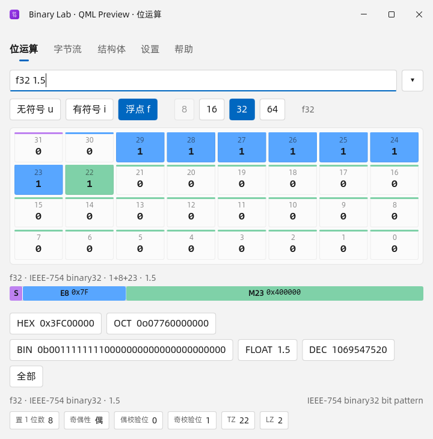

# Binary Lab（`ra9fael.binarylab`）

> **简体中文（默认）** · [English](README.en.md)
>
> Win顺 默认使用中文界面，也自带英文模式。因此中文说明放在 `README.md`，
> 英文说明放在 `README.en.md`，两份内容保持一致，可互相跳转。

给嵌入式开发用的 Win顺 常驻插件：解析 `hex` / `bin` / `oct` 字符串、可视化位运算、
计算 C 风格结构体布局、按 hextract TOML 格式解码记录。所有计算都是有界、纯内存的
操作。结果行和 `preview.text` 由宿主渲染；可选的**交互式工作台**只在被触发时打开
自己的窗口：位页可点击置位、拖拽刷位，以任意进制复制修改后的值；字节流页可拖选
字节、切换端序，或按记录格式逐字段查看解码结果。



## GDI / QML 双版本

本分支为 **QML 0.4.0 预览版**。

| 项目 | GDI | QML |
|---|---|---|
| 分支 | `gdi`（默认） | `qml` |
| 标签 | `gdi-vX.Y.Z` | `qml-vX.Y.Z` |
| 安装包 | `ra9fael.binarylab-gdi-X.Y.Z.wsplugin` | `ra9fael.binarylab-qml-X.Y.Z.wsplugin` |
| 运行时 | 原生 Win32 / GDI，无 Qt 依赖 | Win顺提供 Qt 6.12，最低补丁 6.12.0；Win顺 ≥ 0.22.0 |
| 状态 | 稳定版 | 预览版；bits 窗口可用，bytes / struct / 设置窗口页仍在移植 |

两版的插件 ID 都是 `ra9fael.binarylab`，**同一个 Win顺配置内互斥安装**。
导入另一版的 `.wsplugin`，确认替换即可；同版本覆盖和降级也走此确认。
宿主先停止旧进程，再整体替换安装目录；设置、快捷键和独立数据目录保留。
历史使用同一个 `history.jsonl` 格式。切回 GDI 后不会把 QML DLL 留在安装目录。
开发目录链接不能直接被安装包替换，请使用独立测试配置。

从 [Releases](https://github.com/ra9fael/winshun-binarylab/releases) 按 GDI / QML 名称选择包，
QML 的 Release 标记为 Pre-release。版本号各自递增；安装包旁边提供 SHA256。
当前手动选择版本更新；尚未接入会跨版本类型切换的自动更新源。

图标来自同一套 Phosphor binary 图形，覆盖插件列表、EXE、窗口及自绘标题栏。
ICO 含 16 / 20 / 24 / 32 / 40 / 48 / 64 / 256 像素；QML 使用同源 PNG 资源。

## 安装

1. 从 [Releases](https://github.com/ra9fael/winshun-binarylab/releases) 选择 **QML**，下载 `ra9fael.binarylab-qml-<version>.wsplugin`。QML 选带 Pre-release 标记的版本。
2. 可用旁边的 `.sha256` 文件与 `Get-FileHash <file> -Algorithm SHA256` 核对完整性。
3. 在 **设置 → 插件 → 已安装 → 添加插件 → 压缩包（.zip / .wsplugin）** 中导入。全新安装后打开插件开关并确认权限。

**更新或切换界面版本：** 导入目标包并确认替换；同版本覆盖与降级也允许确认。保留同 ID 的配置和独立数据目录。
**卸载：** 在 **设置 → 插件 → 已安装** 中移除。

本次通过独立 GitHub Release 分发，尚未提交双版本插件库索引或配置自动更新源。QML 包含 `binarylab.exe` 与 `BinaryLabApp.dll`，使用宿主 Qt 6.12（最低补丁 6.12.0），不捆绑 Qt 运行时。

## 从源码构建

需要 MSVC x64 Release 和 Qt 6.12.0；按照 `release.json` 的固定提交取得 WinShun 源码，
设置 `-DWINSHUN_DIR=<源码目录> -DCMAKE_PREFIX_PATH=<Qt kit>`。
可设置 `-DBINARYLAB_OUTPUT_DIR=<独立目录>` 避免覆盖运行中的程序，打包时传入同目录的 `--build-dir`。

以下工作台详细说明保留了 GDI 的行为规格；QML 当前仅 bits 页已实现，
bytes / struct 查询仍由共享计算核心处理，相关窗口页和设置页不属于本预览版已实现功能。

环境要求：Windows 10/11 x64、CMake 3.21+ 和 Visual Studio 2022 及以上（MSVC x64）。
qml 分支的 QML 工作台动态链接 Win顺 的 Qt（共享 Qt 契约只支持 MSVC），MinGW 构建
不适用；打包和集成测试需要 Python 3.10+。

> QML 工作台原型额外需要 Qt 6（推荐 6.12，MSVC 2022 64 位套件）和旁边的 WinShun
> 源码 checkout（CMake 变量 `WINSHUN_DIR`，默认 `../WinShun`）。预览原型无需宿主：
> `binarylab.exe --bits --app-dir <Win顺安装目录> [表达式]`。

```powershell
cmake -S . -B build -A x64                 # MSVC
cmake --build build --config Release       # 在 plugin.json 旁边生成 binarylab.exe
ctest --test-dir build -C Release --output-on-failure
python tools/package.py                    # dist/ra9fael.binarylab-qml-<version>.wsplugin
```

本地构建如何直接在 Win顺 里运行，以及测试和发版流程，见
[CONTRIBUTING.md](CONTRIBUTING.md)。

## 命令

| 关键词 | 示例 | 作用 |
|---|---|---|
| `bits` | `bits u8 0xA5 & 0x0F` | HEX / BIN / OCT / DEC 行，`~ & \| ^ << >> rol ror`，字段 `get/set/clear/toggle`，悬停预览里的位网格 |
| `bytes` | `bytes hex u16le 34 12 78 56` | 归一化字节流，按类型和字节序解码字，带偏移和 ASCII 的 hexdump，浮点数的 IEEE-754 拆解；`bytes fmt` 按 hextract TOML 格式解码记录 |
| `struct` | `struct pack=4 struct Frame { u8 sof; u32 seq; u16 len; u8 data[3]; };` | `sizeof` / `alignof`、成员偏移、padding 行、字节图、可复制的 `static_assert` 文本 |

### `bits` 语法

```
bits [u8|u16|u32|u64|i8|i16|i32|i64|f16|f32|f64] EXPRESSION
     运算符   : ~ + -（一元） · ** · * / % · + - · << >> rol ror · & ^ | · 括号
     raw bits : @0xFF          (按位模式重新解释，例如 i8 @0xFF = -1)
     fields   : get|set|clear|toggle VALUE HIGH:LOW [VALUE]
     literals : 0x… 0b… 0o… 十进制 / 浮点（1.5、1e6、Inf、NaN），_ 分隔符，单位后缀
```

表达式按 C 风格优先级从高到低求值：一元 → `**`（右结合）→ `* / %` → `+ -` →
移位/循环 → `&` → `^` → `|`，括号可任意分组；`bits u8 0xA5 & 0x0F` 这种三段
经典写法仍然可用。求值有两种模式（`evalMode` 设置，工作台设置页可临时切换）：

- **固定宽度**（默认）：每一步结果都掩码到位宽内，发生回绕会在明细里说明。
- **C 模式**：按 C 语言整数提升运算，结果类型自动推导并显示在状态栏；
  有符号溢出报 `E_RANGE`，移位位数越界报 `E_SHIFT`。

显式写出类型前缀时永远按该固定宽度求值（前缀优先）。无符号右移是逻辑右移，
有符号右移是算术右移，`rol` / `ror` 的位数对位宽取模，移位位数 `>= width`
报错，循环移位不报错。字面量按位宽做范围检查，绝不静默截断。

### `bytes` 语法

```
bytes [hex|bin|oct] [TYPE] DATA...
TYPE : u8 i8 u16[le|be] i16[le|be] u32[le|be] i32[le|be]
       u64[le|be] i64[le|be] f16[le|be] f32[le|be] f64[le|be]
```

不带后缀的 `u16` / `u32` / `u64` / `f32` / `f64` 使用 `defaultEndian` 设置；
显式写 `le` / `be` 时永远以它为准。**格式关键字可以省略**：首 token 是类型词
（`u32 0x88775545`）或裸 hex 数据（`deadbeefdeadbeef`，连续书写也行）时按
`hex` 处理，未写类型时默认 `u8`。接受分隔符（`space , : ; _ -`）和
`0x` / `0b` / `0o` 前缀。紧凑 hex token 必须有偶数位，`bin` token 必须正好 8 位，
`oct` token 必须在 `000..377` 之间。输入上限 16 KiB、解码后 4096 字节。
末尾不完整的字会被如实报告，绝不编造一个值。

### `bytes fmt` 语法

```
bytes fmt              列出记录格式（内置 + 设置目录里的 *.toml）
bytes fmt <name> [lsb|msb] <hex...>
```

`name` 匹配 `[format].name`，重名时内置格式优先、目录文件按文件名排序后
后者覆盖前者。`lsb` / `msb` 缺省用格式的 `byte_order`。数据是**纯 hex**：
接受 `0x` 前缀和 `space , : ; _` 分隔符（不支持 `bin` / `oct`），奇数位报
`E_HEX_ODD`，上限 4096 字节。解码按字（`word_bits` 位）切记录、字段按声明
顺序做位切片（数组字段 `count` 份连续同型小端值），记录数上限 24 条、
单条 4096 位。规则命中的记录行带底色标注，悬停明细写明命中了哪条规则。

### 记录格式（hextract TOML）

格式文件与 [hextract](https://github.com/ra9fael/hextract) 同一套 TOML schema，
只有这里列出的键是合法的，未知键 / 类型错误按文件内行号报错，坏文件保留一条
标红的错误行而不是拖垮整个列表：

```toml
[format]
name = "blm_rawdata_256"        # bytes fmt 引用的名字
description = "..."             # 可选
word_bits = 256                 # 1..4096，一条记录的位宽
byte_order = "lsb-first"        # lsb-first（默认）| msb-first，整条记录反转

[[field]]
name = "integral"               # 字段名，规则里用它引用
type = "i16"                    # u8 i8 u16 i16 u32 i32 u64 i64（一律小端取值）
count = 6                       # 可选：数组字段（≤256）
bits = "5:2"                    # 可选：位切片（单数或 "hi:lo"），先解码完整标量再提取
radix = "hex"                   # 可选：显示基数 hex | dec
scale = 0.1                     # 可选：显示倍率（只影响显示，不影响规则）

[[rule]]
when = "any(v < 0 for v in integral)"   # 每条记录求值一次，第一条命中生效
bg = "#f6caca"                  # 可选：命中底色
fg = "#9a9a9a"                  # 可选：命中前景色
```

上面未列出的键不合法（`[[rule]]` 还接受可选的 `name`）。`when` 是 hextract 的
表达式**子集**：字面量、`True`/`False`、字段名（数组字段是
元组）、循环变量、`arr[i]`、一元 `+ - not ~`、`** * / // % + - << >> & ^ |`、
链式比较 `== != < <= > >=`、`and` / `or`，以及 `any` / `all` / `min` / `max` /
`abs` / `len` 和单生成器参数 `f(EXPR for v in ARR)`。整数运算遵循 Python 语义
（精确整数、地板除、`%` 随除数符号）；属性、切片、字符串、未知名字一律在加载时
拒绝。规则还有硬上限：每条 ≤256 个 AST 节点、嵌套 ≤32 层、每条记录求值 ≤4096 步。

格式来源：内置 2 个 BLM 格式（`blm_rawdata_256`、`blm_interlock_512`），加上
[设置](#设置)里 `formatDir` 目录下的 `*.toml`（按文件名排序，最多 64 个、
每个 ≤64 KiB；子目录不递归）。这是插件唯一读文件的地方，由 `files:read` 权限
声明。

### `struct` 语法

```
struct [pack=0|1|2|4|8|16] struct Name { MEMBER; ... };
MEMBER : TYPE name [N];
TYPE   : u8 i8 u16 i32 u64 f32 f64 | 已定义的具名类型
       | struct [Name] { ... } name;   |  union [Name] { ... } name;
       | struct Name name;             (引用前面的定义)
```

`pack=0` 表示自然对齐；查询中最后一个定义才是被布局的那个。成员布局用
`align_up(offset, min(natural_align, pack))`，尾部补齐到结构体的有效对齐。
位域、`int`、`long`、指针、`size_t`、空聚合体、重复成员名、前向引用和递归类型
一律拒绝而不是猜测：这些都是 ABI 相关的，猜了只会给出一个看起来很确定、
其实是错的答案。

## 动作

动作按固定顺序声明；决定键盘映射的是**顺序**，不是 `key` 字符串。`bits` 行上
编辑器可用，所以 `copyPrimary` 和 `openEditor` 共用 Enter / Ctrl+Enter，
`copyDetail` 从宿主动作菜单进入。具体分配由 `bitsEnter` 设置决定。

| 命令 | Enter | Ctrl+Enter | Shift+Enter | 菜单（无按键） |
|---|---|---|---|---|
| `bits`（默认 `bitsEnter=copy`） | `copyPrimary` —— 复制该行主值 | `openEditor` —— 打开交互式工作台 | `chainQuery` —— 把后续查询填进输入框 | `copyDetail` —— 复制完整文本 |
| `bits`（`bitsEnter=editor`） | `openEditor` | `copyPrimary` | `chainQuery` | `copyDetail` |
| `bytes` | `copyPrimary` | `openEditor` —— 打开字节流工作台 | `chainQuery` | `copyDetail` |
| `struct` | `copyPrimary`（摘要会展开成员） | `copyDetail` | `chainQuery` | — |

例外：`bits` / `bytes` / `struct` 结果栏**第一行**都是专用的工作台入口，无论
`bitsEnter` 设成什么，Enter 都是 `openEditor`、Ctrl+Enter 是 `copyPrimary`。
只输入 `bits ` / `bytes ` / `struct `（关键字后一个空格）时第一行也是这个入口，
直接 Enter 即可进入对应页签的空白工作台（表达式框留空，下面保留帮助示例行）。

在 `struct` 摘要行按 Enter 会通过 `effects.replace` 展开成每个成员 / padding
各一行，而不是复制。

### 交互式位编辑器

从结果栏第一行按 Enter 触发；只输入 `bits ` 后按 Enter 也可以，此时表达式框留空、
位宽取 `defaultWidth`。其余进制行按各自映射（默认 Ctrl+Enter，`bitsEnter=editor`
时为 Enter）。窗口由插件自己持有，与插件其余部分一样运行在 strict sandbox 下。窗口内：

| 输入 | 效果 |
|---|---|
| 点击某个位格 | 翻转该位 |
| 在格子上拖拽 | 刷成第一格的值 |
| 方向键 | 移动焦点格（左右 ±1，上下 ±8）；焦点格显示黄色边框 |
| Space | 翻转焦点位 |
| Ctrl+C / B / D / O | 以 HEX / BIN / DEC / OCT 复制值到剪贴板 |
| Enter（在表达式框内） | 重新求值，并把这条表达式提交进历史 |
| ↑ / ↓ | 翻阅已提交的历史；↓ 越过最新一条会恢复你原本输入的内容 |
| 表达式框右侧 ▾ | 展开最近 12 条历史，点击回填并立即求值，行尾 ✕ 删除单条 |
| Esc | 关闭（历史下拉打开时先收起下拉） |

编辑时结果 chips 实时显示四种进制。窗口运行在自己的 GUI 线程上；Win顺 关闭时通过
插件析构函数销毁它。窗口打开时表达式框自动获得焦点。设置页还有会话内的
运算模式（固定宽度 / C）切换；C 模式下位宽 / 符号工具栏被禁用，类型由表达式推导。

#### 单位后缀（纯 ASCII）

| 类别 | 词头 | 倍率 | 例 |
|---|---|---|---|
| SI 十进制 | `k`/`K`、`M`、`G`、`T` | 10³ / 10⁶ / 10⁹ / 10¹² | `4M` = 4,000,000 |
| IEC 二进制 | `Ki`、`Mi`、`Gi`、`Ti` | 2¹⁰ / 2²⁰ / 2³⁰ / 2⁴⁰ | `4Mi` = 4,194,304 |
| 字节写法 | `KB`/`MB`/`GB`、`KiB`/`MiB`/`GiB`/`TiB` | 分别跟随上面两行 | `4MB` = 4,000,000，`4MiB` = 4,194,304 |
| SI 分数 | `m`、`u`/`micro`、`n`、`p` | 10⁻³ / 10⁻⁶ / 10⁻⁹ / 10⁻¹² | `1u` = 10⁻⁶ |

- 后缀必须紧贴数字、且只对十进制字面量剥离：`0xAB` 的 `B` 和 `0xDEADBEEF` 仍是合法 hex 数字。`E` 永久留给指数（`1E6` = 1e6），`M` 与 `m` 大小写敏感。
- `u` 是 micro（10⁻⁶），**不是** C 的 unsigned 后缀；也可写 `micro` 或 `1e-6`。打不出 `µ` / `μ` 就用这三种，直接输入它们会报 `E_BAD_UNIT` 并给出提示。
- 位号与位段值不接受单位（`get 0xA5 7K:4` 报 `E_UNIT_ON_INDEX`），后缀与数字之间留空格会报 `E_UNIT_ATTACH`。
- 换算式不会静默生效：结果明细写 `4Mi = 4 x 2^20 = 4194304`，状态栏显示紧凑形式 `4Mi -> 4194304`；超出位宽仍报 `E_RANGE`。

#### 浮点位模式

`1.5`、`.5`、`1e6`、`1_000.25`、`Inf`、`-Inf`、`NaN` 会编码成 IEEE-754 位模式，默认 `f64`（binary64），`f32` 前缀用 binary32，`f16` 前缀用 binary16（舍入为就近偶数，超出范围时明细会注明变成 ±Inf 或 0）。三种容器来自同一张表，`f128`、`bf16` 等未实现的写法报 `E_FLOAT_TYPE`，不再误报成数字错误。HEX / OCT / BIN 显示编码后的位模式，FLOAT chip（浮点时替代 DEC）显示可往返还原的最短十进制文本，位格顶部用紫 / 蓝 / 绿标出 S / E / M 三段。

**浮点条带**：浮点模式下位格下方恒定展开一行 S | E | M 比例条，每块显示位数和字段原始值，点击复制该字段（如 `0x7F`）；网格里置 1 的位直接以所属字段的颜色填充，悬停时该字段的位提亮。鼠标指向一块时，说明行给出位范围、去偏移指数等，网格里对应的位同时高亮，反过来指向位格也会点亮所属的块。结果为整数时默认没有条带；`floatBar` 设置为 on 后，整数模式（位宽 16 / 32 / 64）也显示调暗的「假设按 f16/f32/f64 解释」预览条带，8 位没有对应容器，只显示灰条和提示。窗口高度随结果类型在整数 / 浮点之间切换时变化，条带本身不再有开关。

**工具栏切换浮点**：位宽右边的「类型」行是 `无符号 u | 有符号 i | 浮点 f`。浮点下位宽按钮显示为 `f16 / f32 / f64`，8 位没有容器所以置灰。在浮点容器之间切换按**数值**重新编码（`f32 1.5` → `f64 1.5`，舍入或溢出写进明细）；整数和浮点之间切换保持**位不变**、只换解释（`u32 0x3FC00000` ⇄ `f32 0x3FC00000`，与条带的「假设」读法一致）。切到有符号时表达式写成 `i32 @0x…`，因为最高位为 1 的十六进制字面量超出有符号范围，`@` 表示原始位。

**浮点前缀后的十进制整数是数值**：`f32 88` = 88.0 = `0x42B00000`，`f16 65504` = `0x7BFF`。原始位模式请写成 `0x…` / `0b…` / `0o…` 或 `@88`。位运算式里的操作数不受影响（`f32 0x3FC00000 | 1` 仍是对位模式按位或）。

不做浮点算术：浮点**字面量**只能单独出现，`1.5 & 0xFF` 报 `E_FLOAT_OP`，`u32 1.5` 报 `E_FLOAT_TYPE`。要对编码后的位模式做位运算，请写原始位模式，例如 `f32 @0x3FC00000 & 0x007FFFFF`。小数单位（`1m` / `1u`）同样走这条路径。

#### 历史记录

只有按 Enter 提交且求值成功的表达式才进历史，实时求值不会刷屏。历史以 JSONL 追加写到宿主的 `dataDir/history.jsonl`，上限 200 条、相邻去重；若 strict sandbox 不允许写盘，自动退化为「仅本次会话」，设置页会标明。下拉里每条行尾的 ✕ 删除单条（同步重写文件），设置页与下拉底部的「清空历史」按钮同时清空内存和文件。**不新增第 6 个 tab**：历史是输入辅助，下拉可以在看着位网格的同时使用。

查询没有副作用：不删文件、不启动程序、不改剪贴板、不开窗口。复制和 `setQuery`
效果只在用户触发动作时返回。`bits ` 不带参数时，第一行是**有效**的
「打开二进制工作台」入口（`Enter` 打开空白工作台），下面保留三行示例
（`valid: false`，Tab 可填充）；`bytes ` / `struct ` 同样给出对应页签的
空白工作台入口加帮助示例行。
解析失败会显示一行 `valid: false`，带错误码和修正后的示例。

### 字节流工作台（bytes 页）

`bytes` 结果的第一行 Enter（或任意 `bytes` 行 Ctrl+Enter）打开。窗口顶栏的五个页签
中 `bits` / `bytes` / `struct` 是内容模式，共用同一个表达式框——页签切换时各自
保留自己的表达式文本，切换回来立即重新求值。字节页有两种形态：

**标量模式**（`hex|bin|oct [TYPE] DATA...`）：左偏移、中十六进制（每行 16 字节）、
右 ASCII 的三段网格。单击选中字节，拖拽扩展选区，方向键移动并自动滚动跟随，
滚轮上下翻行、Shift+滚轮横向翻列。当前字按表达式的类型词（`u16` 等）和端序解码，
HEX / DEC|FLOAT / BIN 三个 chip 显示该字的值并可点击复制；工具栏的位宽 / 符号
按钮重写类型词，LE / BE 按钮重写 `le` / `be` 后缀（大端下 `34 12` 读出
`0x7856`）。Ctrl+C 复制整个选区的连续 hex。

**记录模式**（`fmt <name> [lsb|msb] <hex...>`）：顶行是格式下拉（内置 +
设置目录里的全部格式，加载备注和坏文件错误也在这里展示），下方是记录表格：
每条记录一行、每个字段一列（数组字段按元素展开，如 `integral0..integral5`），
命中规则的行按规则着色（`bg` / `fg`），规则求值错误以红色文字标在该行。
点击单元格选中记录 / 字段，chip 显示该字段的十进制 / 十六进制值；
LSB / MSB 按钮重写表达式里的字节序词。滚轮翻记录，Shift+滚轮横向翻列。

表达式行与位页同源：输入即求值，出错时保留上一次的有效结果并在状态栏给出
完整错误；清空表达式即回到空白状态。「送到位运算页」把当前字的原始位（记录模式
则是选中字段的原始位）交给位页继续分析。Esc 关闭窗口（下拉先收起）。

## 设置

| 键 | 类型 | 默认值 | 含义 |
|---|---|---|---|
| `defaultWidth` | choice | `32` | 未写类型时 `bits` 的位宽 |
| `defaultEndian` | choice | `le` | 未显式写 `le` / `be` 的类型的字节序 |
| `defaultPack` | choice | `0` | 省略 `pack=N` 时 `struct` 的 pack |
| `bitsEnter` | choice | `copy` | `bits` 行上复制 / 编辑器谁占用 Enter。`copy`（默认）= Enter 复制、Ctrl+Enter 打开编辑器；`editor` 反之。 |
| `evalMode` | choice | `fixed` | 表达式求值模式。`fixed`（默认）每步结果固定在位宽内并报告回绕；`c` 按 C 语言整数提升、结果类型自动推导。显式类型前缀始终按固定宽度求值。 |
| `formatDir` | folder | （空） | `bytes fmt` 读取此目录下的 `*.toml`（hextract 格式，只读，最多 64 个、每个 ≤64 KiB）；留空只用内置的两个 BLM 格式。`settingsChanged` 时重新扫描。 |
| `floatBar` | choice | `off` | 整数模式下是否显示「假设按浮点解释」的预览条带；浮点模式下条带与字段色恒定显示，不受此设置影响。 |

设置在 `initialize` 时读取，并在 `settingsChanged` 时刷新；不涉及任何密钥。

## 权限与数据

`runtime.sandbox` 为 `strict`。用 `wsbench` 实测：插件进程运行在
**LOW 完整性级别、未提权、置于 job object 内**。manifest 声明三个权限，
分别只服务于编辑器窗口和记录格式目录：

| 权限 | 原因 | 可否强制 |
|---|---|---|
| `ui` | 编辑器窗口（仅在用户触发 `openEditor` 动作时创建）。 | 部分 —— 没有它，job 会阻止 desktop / USER 句柄，窗口根本无法存在。 |
| `clipboard:write` | 编辑器的复制按钮直接写入修改后的值。协议没有插件→宿主的复制工具，所以窗口内部拿不到宿主代劳的 `copy` 效果。 | 是。 |
| `files:read` | 只读 `formatDir` 设置所选目录下的 `*.toml`（记录格式，见 [记录格式](#记录格式hextract-toml)）；不递归子目录、不读其他任何路径、不写盘。 | 是（主机按目录把关）。 |

纯文本用法不需要任何一个权限：查询和其余动作保持零副作用（不碰文件、剪贴板、
窗口）。未声明 `network`、`files:write`、`clipboard:read`、`processes`、
`notifications`、`elevated`、`contentSearch`、`ai.expose`、`hostHotkeys` 能力。

插件读取 `formatDir` 下的 TOML，并可向宿主提供的 `dataDir` 写入历史；写入不可用时退化为会话历史。密钥必须使用宿主的 `password` 设置类型；
这里没有用到。不上传任何用户数据：没有任何网络调用。

## 构建与运行时依赖

- Windows，支持 C++ 常驻插件协议的 Win顺（JSON-RPC 2.0，stdio 上每行一条 UTF-8 消息）。
- MSVC x64 Release：启动器静态 CRT，界面 DLL 动态链接 Qt；不支持 MinGW 共享宿主运行时。
  QML 使用宿主 Qt，并随包提供 BinaryLabApp.dll。唯一的第三方代码是随仓库 vendor 的
  [toml++](https://github.com/marzer/tomlplusplus) v3.4.0（MIT，单头
  `third_party/tomlplusplus/toml.hpp`，以 `TOML_EXCEPTIONS=0` 编译并以 SYSTEM
  include 引入），用于解析记录格式 TOML。
- `winshun.h` 从 `WinShun/src/plugins-sdk/winshun.h` 逐字节复制，插件因此自包含。
- 构建产物直接输出到本目录，因为 `plugin.json` 把 `binarylab.exe` 指定为
  `runtime.program`。构建命令见 [从源码构建](#从源码构建)。

## 验证

本轮两版构建、打包、宿主运行与图标检查见 [双版本验证](docs/variant-validation.md)。
QML 的 bytes / struct / 设置窗口页未完成；GDI 旧版工作台验证不能代表 QML 已支持这些页面。

## 失败处理

解析错误、字面量越界、不支持的 ABI 构造、超出容量上限，都会返回一行不可操作的
结果，带稳定错误码和修正后的示例；不返回部分结果或编造的结果。QML 需要匹配的宿主 Qt 和包内 BinaryLabApp.dll；宿主版本不匹配会拒绝启动，缺失 DLL 会报告启动错误。没有网络请求。所有诊断信息走 stderr（`plugins.log`），
stdout 只承载 JSON-RPC 行。`timeoutMs` 为 1500；在 4096 字节上限下实测最慢查询
约 81 ms p95。

## 分发与版本

发布使用 `<variant>-vX.Y.Z` 标签；`plugin.json` 保持纯数字版本。打包脚本读取 `release.json`，校验类型、必需运行文件和双语版本说明，然后生成 `.wsplugin`、SHA256 与发布说明。QML 作为预览版发布；切换类型始终是用户明确选择的替换安装。流程见 [CONTRIBUTING.md](CONTRIBUTING.md)。

## 许可证

MIT，见 [LICENSE](LICENSE)。发布历史见 [CHANGELOG.md](CHANGELOG.md)。

---

简体中文（默认） · [English →](README.en.md)
